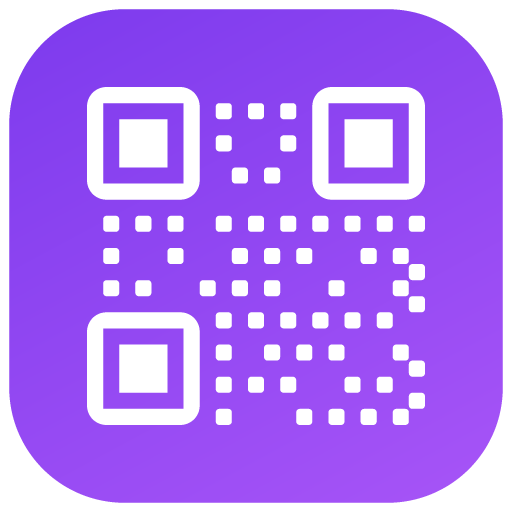

# QR Studio

A premium, private, offline-first QR workspace built with **plain HTML, CSS and vanilla JavaScript**.
Generate styled QR codes, produce batches, scan with a camera or image, and keep a searchable local
library — with no backend, no accounts, no analytics and no runtime CDN.



## Why QR Studio

- **100% local.** QR rendering, scanning, image processing, ZIP creation and CSV parsing all happen in
  your browser. Nothing is uploaded, tracked or sent to a third party.
- **Offline-first PWA.** A versioned service worker precaches the complete app shell, so it opens and
  works without a connection after the first visit.
- **Bilingual and bidirectional.** Full English and Arabic dictionaries with automatic RTL layout.
- **Premium themes.** Carefully tuned light and dark themes with a purple accent, glassy top bar,
  responsive cards and reduced-motion support.

## Features

### QR Generator

Eight standards-compliant QR types:

| Type | Payload |
| --- | --- |
| URL | Normalised `http(s)` link |
| Text | UTF-8 text |
| Wi-Fi | `WIFI:T:WPA;S:<ssid>;P:<password>;H:<hidden>;;` |
| Email | `mailto:` with optional subject and body |
| Phone | `tel:` |
| SMS | `SMSTO:` with message |
| vCard | vCard 3.0 contact card |
| Location | `geo:` coordinates with optional label |

- Live preview with validation and human-readable errors.
- Colours, solid or gradient fills, dot and corner styles, background colour, quiet-zone margin,
  error-correction level, export dimensions and ready-made presets.
- Optional logo upload: PNG, JPG or SVG, validated and sanitised, raster logos resized/compressed,
  processed size capped at **300 KB**, adjustable logo size and margin. Uploading a logo raises error
  correction to **H** when it is currently lower.
- Readability check that warns when foreground/background contrast makes a code hard to scan.
- Export to **PNG, SVG or JPG**, copy the image, print, choose a filename, and save to History or
  Favorites.
- Edit an existing record without losing its payload or styling.

### Batch Generator

- Add up to **1,000** rows from pasted lines or a local CSV file (parsed locally with PapaParse).
- Row-level validation, inline editing, type switching, removal, pagination and “remove invalid”.
- CSV template download and drag-and-drop import (5 MB limit).
- PNG or SVG output, selectable dimensions, custom filename prefix and optional CSV manifest.
- Downloadable ZIP with unique, zero-padded filenames (JSZip, local).
- Progress indicator, cancellation, failure reporting and a manifest that records successful, failed
  and skipped rows.
- Batch runs yield to the main thread so the interface stays responsive.
- Batch supports Text and URL rows; structured types (Wi-Fi, vCard, etc.) remain in the main generator.

### QR Scanner

- Camera scanning using the native **BarcodeDetector** when available, with a local **jsQR** fallback.
- Image upload or drag-and-drop, also decoded entirely on-device.
- Camera device selector, permission/error guidance, torch control when the browser exposes it.
- Camera stops automatically when you leave the page or hide the tab.
- Scanning never auto-opens a URL. Links require an explicit **Open** action, and all decoded content
  is rendered as escaped text.
- Scan history (latest **60**), copy, open-link and clear-with-confirmation.

### Library

- **History** keeps the latest **100** records; **Favorites** up to **1,000**.
- Search, type filter and sorting by newest, oldest, label or type.
- Lazy QR thumbnails, preview dialog, download, print, copy image/text, edit, favorite and delete.
- Undo for single deletions and bulk clear actions.
- Compact metadata storage: records keep payload, fields, style and logo references — not repeated
  Base64 images.

### Backup and settings

- JSON export with app marker, schema version, settings, history, favorites, scans, activity and logos.
- Import with validation, version checks and a merge-or-replace choice.
- Replace imports require explicit confirmation and create a safety snapshot that can be undone.
- Theme (light/dark/system), language, default error correction, default size, default margin,
  local data counts, logo pruning, storage estimate and complete data clearing.
- Storage-quota failures surface as clear messages instead of silent data loss.

### PWA

- Installable manifest with local SVG/PNG icons and shortcuts.
- Versioned cache; old caches are removed on activation.
- In-app “update ready” prompt; updates only apply when you accept them.
- Offline badge, install button and safe offline shell fallback.

## Local development

The app is a static site, but ES modules, `fetch()` for locale files and service workers require an
HTTP origin. Do **not** open `index.html` directly with `file://`.

### Option 1 — bundled zero-dependency server

Requires Node.js 18 or newer.

```bash
node tools/dev-server.mjs
```

Open <http://127.0.0.1:4173/>. Change the port if needed:

```powershell
$env:PORT=8080; node tools/dev-server.mjs
```

```bash
PORT=8080 node tools/dev-server.mjs
```

### Option 2 — any static server

```bash
python -m http.server 4173
# or
npx --yes serve .
```

Camera access works on `http://localhost` / `http://127.0.0.1` and on HTTPS origins. Other plain-HTTP
hosts are treated as insecure by browsers and the scanner will explain that.

## Deployment

Everything is static; there is no build step.

### Vercel

1. Push the folder to a Git repository.
2. In Vercel, **Add New → Project** and import the repository.
3. Framework preset: **Other**. Root directory: the folder containing `index.html`.
4. Build command: none. Output directory: `.` (the repository root).
5. Deploy. Vercel serves the site over HTTPS, so the camera and service worker work.

### GitHub Pages

1. Push the folder to a repository (the project may live in a subpath).
2. **Settings → Pages → Build and deployment → Deploy from a branch**.
3. Select the branch and `/ (root)`, then save.
4. Open the published HTTPS URL.

All asset references are relative (`./…`), and the hash router uses `#/route` URLs, so the app works
from both a domain root and a project subpath without rewrite rules.

## Data and privacy

| Store | Key | Contents |
| --- | --- | --- |
| LocalStorage | `qs.state.v1` | History, favorites, scans, activity, statistics |
| LocalStorage | `qs.settings.v1` | Theme, language, generator defaults, flags |
| IndexedDB | `qrstudio` database | Logos (with a LocalStorage fallback) |
| SessionStorage | `qs.edit.v1`, `qs.newqr.v1` | Transient edit/prefill hand-off |
| SessionStorage | `qs.backup.safety.v1` | Safety snapshot for replace-import undo |

Clearing site data or using **Settings → Your data → Clear all data** removes these stores. Export a
backup first if you want to keep your library.

There are no network requests at runtime beyond loading the app's own files. All third-party libraries
are vendored under `lib/` with their licenses.

## Project structure

```
.
├── index.html               App shell, pre-paint theme/language script
├── manifest.json            PWA manifest
├── service-worker.js        Versioned offline cache
├── css/
│   ├── main.css             Tokens, reset, shared primitives
│   ├── layout.css           Sidebar, topbar, page grids
│   ├── components.css       Buttons, forms, cards, modals, previews
│   ├── generator.css        Generator + batch workspace
│   ├── scanner.css          Scanner workspace
│   └── responsive.css       Breakpoints and RTL polish
├── js/
│   ├── app.js               Boot, shell, theme/language, PWA, shortcuts
│   ├── router.js            Hash router, lazy views, cleanup
│   ├── config.js            Limits, types, defaults
│   ├── storage.js           State, history, favorites, scans, activity
│   ├── db.js                IndexedDB logo store
│   ├── i18n.js              Dictionary loading and interpolation
│   ├── themes.js            Theme application
│   ├── ui.js                Modals, toasts, confirmation, printing
│   ├── payloads.js          QR payload builders and validators
│   ├── qr-engine.js         Styled QR rendering, logos, export blobs
│   ├── export.js            Record download/copy helpers
│   ├── records.js           Record cards, preview, actions
│   ├── library-view.js      Shared History/Favorites view
│   ├── dashboard.js         Overview
│   ├── generator.js         QR generator
│   ├── batch.js             Batch generator
│   ├── scanner.js           Camera/upload scanner
│   ├── history.js           History view
│   ├── favorites.js         Favorites view
│   ├── settings.js          Settings and local data
│   ├── backup.js            Backup validation/import/export
│   └── about.js             About page
├── locales/
│   ├── en.json              English dictionary
│   └── ar.json              Arabic dictionary
├── lib/
│   ├── qr-code-styling/     QR rendering (MIT)
│   ├── jsqr/                QR decoding fallback (Apache-2.0)
│   ├── jszip/               Batch ZIP creation (MIT / GPLv3)
│   ├── papaparse/           CSV parsing (MIT)
│   └── lucide/              Generated icon subset (ISC)
├── assets/icons/            App, maskable and logo icons
└── tools/dev-server.mjs     Local static server
```

## Limits

These are deliberate, enforced limits that keep the app reliable without a backend:

- History: **100** records
- Favorites: **1,000** records
- Scan history: **60** entries
- Activity feed: **40** entries
- Batch: **1,000** rows
- Logo source: **300 KB** after processing
- CSV import: **5 MB**
- Backup file: **12 MB**
- Scanner image: **12 MB**
- Batch ZIP runs in the browser; very large batches at 2048 px take time to compress.

## Genuine limitations

- **No cloud sync or accounts.** Data lives in one browser profile on one device. Use JSON backup to
  move it.
- **Storage is finite.** Private browsing, hardened settings or a full disk can block LocalStorage or
  IndexedDB; the app reports quota errors but cannot create space.
- **Clearing browser data deletes the library.** There is no server-side copy.
- **Camera requires a secure context.** HTTPS or localhost is mandatory; some embedded webviews also
  block camera access.
- **BarcodeDetector is not universal.** When it is missing, the bundled jsQR fallback is used. It is
  slower and may struggle with tiny, blurry, low-contrast or heavily stylised codes.
- **Torch depends on hardware and browser support.** The button only appears when the active track
  exposes a torch capability.
- **Logo scannability.** Logos obscure modules. QR Studio caps logo size, raises ECC to H and checks
  contrast, but extreme colour combinations or oversized logos can still break scanning. Test before
  printing.
- **SVG logo sanitisation is defensive, not a full security boundary.** Only local files you choose are
  processed; no remote SVGs are loaded.
- **Styled QR codes are not always ideal for industrial scanners.** High-contrast, generous quiet zones
  and standard square modules remain the most reliable choice.
- **The service worker caches only the app shell.** There is no background sync, push or server data.
- **First visit needs a connection.** After that, the installed app works offline.
- **No automated batch retry queue.** Failed rows are reported in the result panel and manifest; fix the
  rows and run again.
- **RTL is complete for UI copy and layout**, but user-entered payloads may legitimately stay LTR (URLs,
  Wi-Fi credentials, vCards).
- **Printing uses the browser print dialog.** Margins, headers and paper size depend on the browser and
  printer settings.
- **No warranty.** Test critical QR codes with the devices and scanners you plan to use.

## Keyboard shortcuts

| Shortcut | Action |
| --- | --- |
| `Ctrl / ⌘ + K` | Focus the current search field |
| `Ctrl / ⌘ + S` | Save on the generator page |
| `Ctrl / ⌘ + Shift + L` | Switch language |
| `Esc` | Close a modal/drawer or cancel text colour editing |

## Browser support

Modern evergreen browsers: Chrome/Edge 100+, Firefox 100+, Safari 16.4+.
PWA installation, BarcodeDetector, torch and camera selection vary by browser and platform; the app
degrades gracefully and falls back to jsQR and image upload.

## Credits and licenses

Vendored dependencies retain their original licenses:

- [qr-code-styling](https://github.com/kozakdenys/qr-code-styling) — MIT
- [jsQR](https://github.com/cozmo/jsQR) — Apache-2.0
- [JSZip](https://stuk.github.io/jszip/) — MIT or GPLv3
- [PapaParse](https://www.papaparse.com/) — MIT
- [Lucide](https://lucide.dev/) — ISC (generated subset)

QR Studio itself is a self-contained static application. No fonts, scripts, images or APIs are loaded
from external origins at runtime.

---

Built for privacy — nothing leaves your device.
